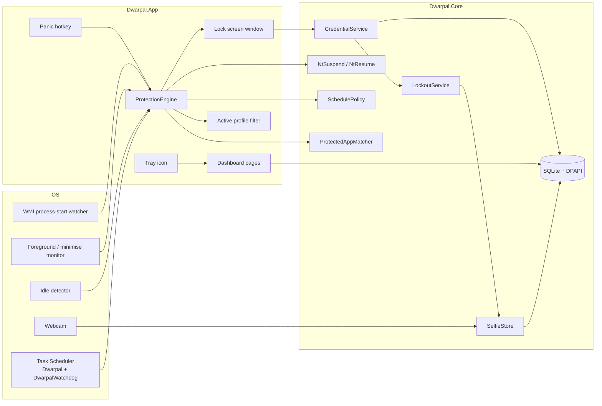

# Architecture

Dwarpal is a single-user Windows desktop application. Three projects share a solution:

| Project | Responsibility |
| --- | --- |
| `Dwarpal.Core` | Domain logic with no WPF dependency: SQLite schema and repositories, Argon2id hashing, DPAPI, credential lifecycle, lockout, schedule policy, process matching and Win32 suspension. |
| `Dwarpal.App` | WPF shell (MVVM with CommunityToolkit.Mvvm), composition root, protection engine, tray icon, global hotkey, lock screen and all pages. |
| `Dwarpal.Service` | Minimal Windows service host for a privileged heartbeat. It does not show UI; interactive enforcement runs in the elevated app. |

## Runtime overview

## Protection lifecycle

1. **Startup.** `App.OnStartup` applies process DACL hardening, registers the panic hotkey, opens the
   unlock or setup window, and starts `ProtectionEngine` when the dashboard opens. The engine loads
   enabled apps, the active profile and schedule windows into an in-memory cache.
2. **Launch detection.** `ProcessStartWatcher` (WMI `Win32_ProcessStartTrace`) reports a process name;
   the engine matches it against the active profile and `ProtectedAppMatcher` (path or process name).
3. **Lock.** The process is suspended with `NtSuspendProcess`, a full-screen `LockScreenWindow` is
   shown on the virtual screen, and a `Lock` event is written.
4. **Verification.** The lock screen calls `LockScreenContext.VerifyAsync`, which delegates to
   `CredentialService.VerifyAsync`. Every attempt is audited; failures increment `LockoutService`.
   On the third failure and each lockout, a selfie is captured, encrypted and linked to the entry.
5. **Resume.** A successful credential resumes the process with `NtResumeProcess`, records the event
   and starts an auto re-lock session.
6. **Re-lock.** A one-second timer checks background/minimise time and system idle against the
   resolved timeout plus grace period. The schedule gate and active profile are applied first.
7. **Exit.** A credential-gated tray exit disposes the engine, resumes suspended processes, removes
   the watchdog task and shuts down.

## Data model

SQLite schema version 4, migrated in place at startup:

| Table | Purpose |
| --- | --- |
| `Settings` | Key/value state: auto re-lock, auto-start, watchdog, lockout counters, active profile, selfie toggle. |
| `Credential` | Single row: kind, Argon2id secret hash, recovery hash, timestamps. |
| `ActivityLog` | Audit trail with event type, outcome, app name/path, detail and optional selfie path. |
| `ProtectedApps` | Display name, executable path, process name, enabled flag, per-app re-lock override, last locked time. |
| `Profiles`, `ProfileApps` | Named subsets of protected apps. Deleting a profile or app cascades its assignments. |
| `Schedules` | Weekday mask (bit 0 = Sunday), start/end minute-of-day, enabled flag. |

The database, logs and selfies live under `%ProgramData%\Dwarpal`, protected by an ACL for SYSTEM
and Administrators. Credential and recovery hashes are DPAPI-encrypted before they reach SQLite;
selfie JPEGs are encrypted individually.

## Scheduling and profiles

- `SchedulePolicy.IsProtectionActive` is a pure function over the enabled windows and local wall-clock
  time. A window with `start > end` crosses midnight; the end belongs to the following day. No
  enabled window means protection is always on.
- The engine re-evaluates the schedule every 20 seconds. Opening a window locks already-running
  protected apps; closing one stops new locks and auto re-locks but does not force-unlock a visible
  lock screen.
- An active profile maps to a set of protected-app ids. `null` means "all apps". Switching profiles
  refreshes the cache and can lock newly covered running apps immediately.
- The panic hotkey bypasses the schedule and profile for already-running apps, but only matches apps
  in the current active profile.

## Security boundaries

| Boundary | Measure |
| --- | --- |
| Secret at rest | Argon2id (64 MiB, t=3, p=4) and DPAPI `LocalMachine`; no plaintext is persisted. |
| Unlock attempts | Constant-time hash comparison, persistent lockout, countdown UI and audit entries. |
| Process tampering | App runs elevated; DACL denies `PROCESS_TERMINATE` to `BUILTIN\Users`; a Task Scheduler watchdog relaunches it. |
| Credential-gated actions | Settings changes that weaken protection, tray exit and recovery require the credential. |
| Audit integrity | Activity writes are best-effort and never block the unlock flow; failures go to Serilog. |
| Data folder | ACL-restricted to SYSTEM + Administrators. |

The user-mode design has deliberate limits (Safe Mode, administrators with physical access, DPAPI
machine scope). They are listed in the README rather than hidden.

## Why these choices

- **WPF + MVVM** keeps a security-focused desktop app native, testable and dependency-light.
- **SQLite** gives transactional local state with a simple `user_version` migration path and no
  service dependency.
- **Task Scheduler watchdog** instead of a session-0 service, because a service cannot display the
  interactive lock screen. `Dwarpal.Service` remains available for a future privileged heartbeat.
- **DPAPI** ties stored hashes and selfies to the machine without a separate key-management service.
- **Pure Core policies** (lockout durations, schedule windows, auto re-lock decisions) are covered by
  unit tests and reused by both the engine and the UI.
